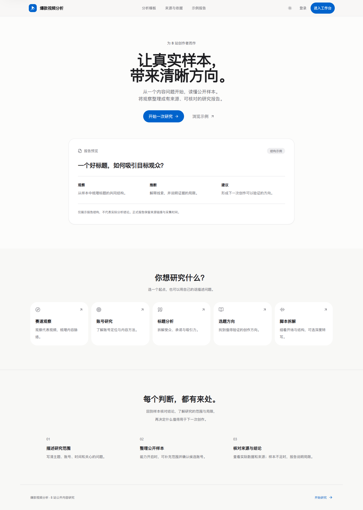
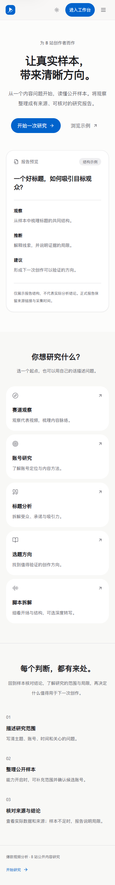
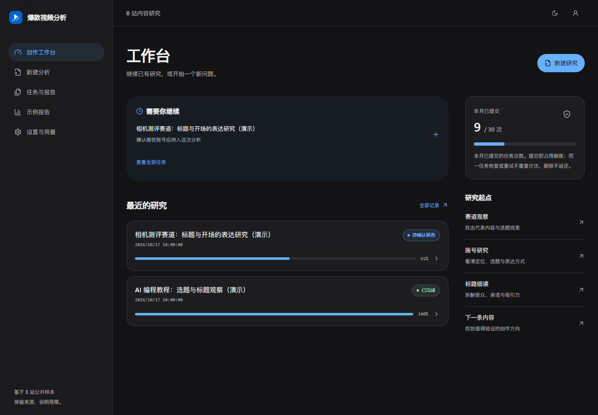
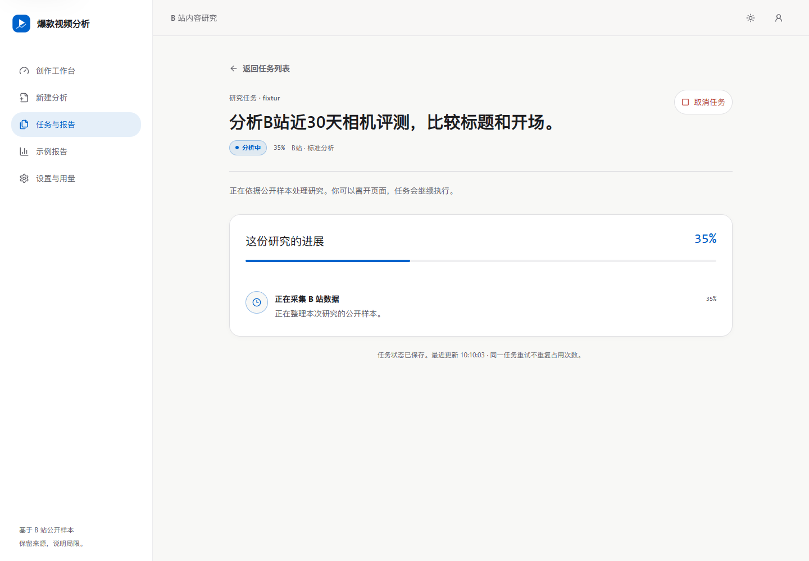
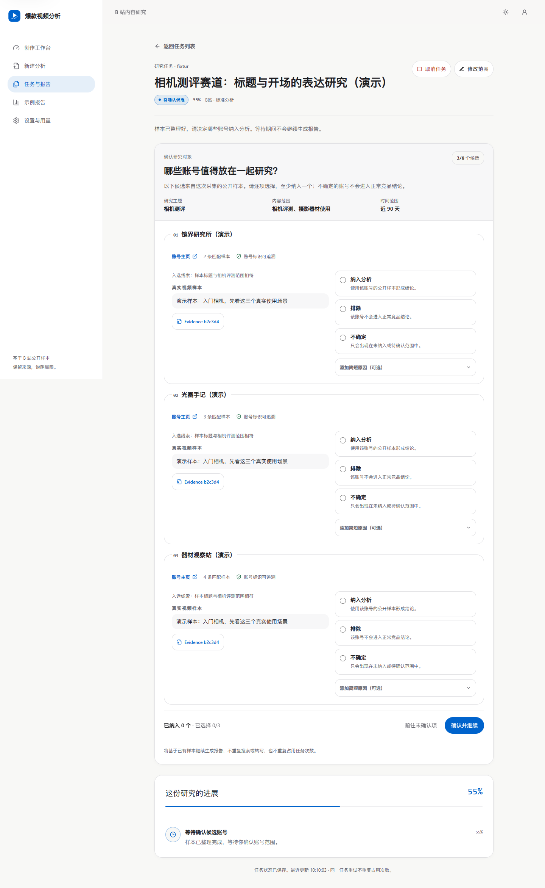
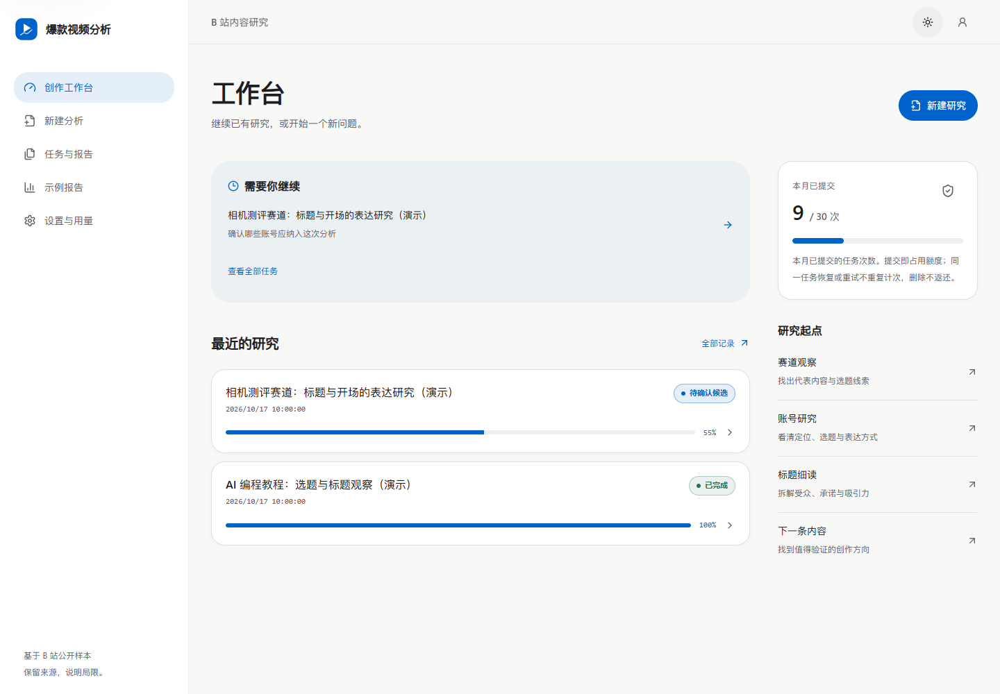
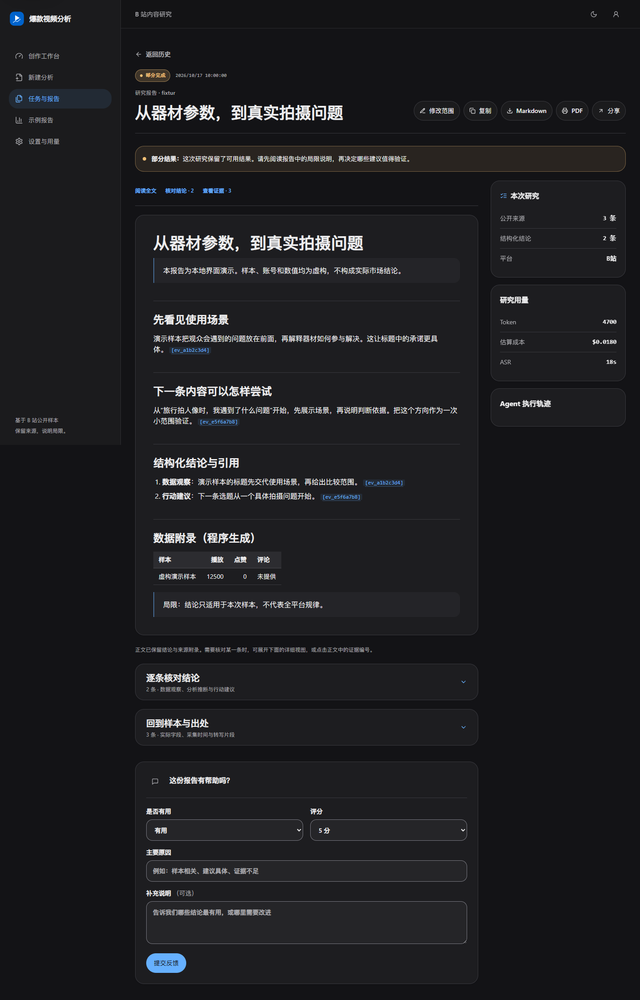
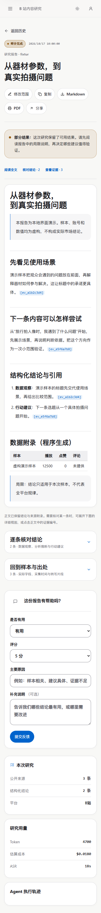

# 爆款视频分析

面向小范围创作者试用准备的 B 站单平台内容研究产品：输入赛道、选题或竞品需求，生成带真实视频样本、来源链接、结构化结论和可执行建议的报告。

> 当前真实视频搜索仅支持 B 站。项目不会宣称支持抖音、快手或小红书实时分析。

当前主线：**稳定性与试用入口完善 → 工程验证并推送 → 网页 ChatGPT 只读复审 → 用户本地真实任务与报告质量验收 → 小范围创作者试用 → 反馈迭代**。本轮不自动部署或调用收费服务。

当前阶段：试用前工程补强后，根据只读复审再补齐“快速领取后重试失败”和“重试断连后延迟提交”两个恢复时序。工程检查与真实业务验收分开记录；后续任务和唯一验收清单见项目状态页。完整业务运行及真实报告质量仍等待用户验收。

2026-10-20 为本轮回归重新创建了独立 `.venv`，按原依赖声明安装，并以 `npm ci` 恢复前端依赖。保留简洁柔和的界面及 10/18 展示图；本轮未改变视觉设计。运行、停止与数据保护见 [本地运行手册](docs/local-development.md)。

- [项目状态、实际验收与唯一任务清单](docs/project-status.md)
- [Windows 启动、停止、测试与数据库备份回退](docs/local-development.md)
- [本轮功能契约与源包历史记录](docs/creator-pilot-20261017.md)

## 核心 Agent 工作流

这个项目首先是一个 LangGraph 多 Agent 系统，Next.js、FastAPI、Arq 和 PostgreSQL 是让它可排队、可恢复、可追踪地运行的产品支撑。`Worker` 只是承载整张状态图的后台进程，不是用来替代 Researcher、Analyst 或 Writer 的单一 Agent。

```text
用户请求
  │
  ▼
Entry：意图 / 平台 / 能力预检（分析主路径为确定性判断）
  │
  ▼
Planner：拆成最多 3 个研究任务
  │
  ▼
Research Loop / Researcher：LLM 选择工具与参数
  ├─ search_videos ─────────────→ Bilibili 公开数据
  ├─ rag_search ────────────────→ ChromaDB 知识库
  ├─ get_transcript（深度模式）─→ MiMo ASR
  └─ 动态能力注册 + Pydantic 参数校验 + MCP 调用/回退
  │  累积结构化 Evidence
  ▼
Evidence Gate：视频实证请求须有有效视频样本；不足则 partial/终止
  │
  ▼
Analyst：基于 Evidence 生成 observation / inference / recommendation
  │  最多 2 轮，输出带 evidence_ids 的结构化 claims
  ▼
Writer：只组织已有 claims 与 Evidence，单次生成报告，不新增事实
  │
  ▼
引用校验 + 确定性附录 + 报告持久化
```

v2 的重点不是“角色数量”，而是把语义决策留给 Planner、Researcher、Analyst、Writer，把平台边界、循环上限、Evidence 门禁和发布校验交给代码。v1 的 Supervisor 集中路由回环仍保留用于同任务 A/B 与回退，但不参与默认正常链路。

默认 v2 深度模式先采集并补充转写，再执行一次 Analyst/Writer；候选确认启用时从冻结快照恢复，不重复采集。v1 仍保留兼容路径。引用校验验证来源编号存在及结构合法，不等同语义事实核查。

## 前端体验

前端采用更简洁柔和的视觉：暖白与石墨灰背景、少量蓝色强调、系统无衬线字体、留白和轻圆角。首次访问默认浅色，已保存的深浅主题偏好继续生效。首页、工作台、表单、候选确认与报告共用颜色和组件，不依赖在线字体或图片素材。



<details>
<summary>移动端首页、用户 Dashboard 与报告详情</summary>














</details>

以上截图于 2026-10-18 由本机 Windows 前端生产构建实际运行生成；工作台、候选、报告使用虚构演示数据，不代表真实研究结果。运行时间和检查项目见 [本机浏览器结果](output/soft-ui-20261018/ui-validation.json)。设计决策见 [前端设计说明](docs/frontend-design.md)，2026-10-17 书房版截图留作历史，功能契约与当时验证说明见 [创作者试用版改进记录](docs/creator-pilot-20261017.md)。[2026-07-15 前端验收记录](docs/frontend-validation-20260715.md) 保留为旧版基线。

### 本轮创作者试用改进

- 提交时预留月度任务额度；相同请求重发不会新建任务，失败、取消、重试和删除后保留已产生的用量。
- Worker 使用执行版本、独立执行标识和心跳租约；超时覆盖完整执行阶段，丢失 Worker 的任务可由调度器有限恢复。
- 领取事务保存真实 Arq 投递 ID，避免快于 API 回填时丢失恢复标记；无队列上下文的执行退回 pending 时保留派发意图。领取阶段短暂数据库故障有限重试；已派发但长期未领取时核对实际 Arq 状态，队列中仍有效的任务不重复派发，丢失或已结束的投递按 CAS 升执行版本恢复，共用重试上限且不新增额度。
- 实时样本请求需要有效视频来源；缺失指标展示为“未知”，报告附录保留实际字段、发布时间、采集时间和样本边界。
- 新建分析保留同一请求的提交标识；范围修订在当前标签页按账号、源任务与内容保存未决请求，503/响应丢失后刷新仍复用幂等键。当前任务页的重试响应不确定时持续核对，旧版本终态不代表重试被拒绝；20 秒仍未确认则暂停自动核对、阻止重复提交，可继续只读核对，发现新执行版本后跟踪至终态。报告支持引用跳转。
- 下载/转码由可终止的子进程树执行，取消和总超时等待清理；MCP 远端取消须有实际清理完成 ACK，3 秒未确认仅告警，不能视为已清理。MCP 使用内部 Redis 转写缓存，缓存故障只记录操作及异常类型。
- 升级需要数据库迁移 `20261017_0005`。部署顺序、额度语义与验证边界见 [本轮记录](docs/creator-pilot-20261017.md)。

## 产品能力

- 注册、登录、退出与 HttpOnly Cookie 会话；密码使用 Argon2 哈希
- PostgreSQL 长期保存用户、任务、报告、Evidence、反馈、用量和分享链接
- Arq + Redis 执行后台分析任务（耗时依赖样本、模型和转写），支持幂等、取消、有限重试、超时和轮询进度
- LangGraph v2 保持默认主链路：Entry → Planner → Research Loop → Evidence Gate → Analyst → Writer
- v1 Supervisor 回环保留为 A/B 与回退，不作为产品默认流程
- 每条 Evidence 获得稳定 `evidence_id`；Observation 必须引用真实 Evidence
- 报告数据附录由程序确定性生成，不完全交给 LLM
- 高熵只读分享链接支持过期与撤销；公开页不暴露用户、成本和内部执行轨迹
- Markdown 导出、浏览器打印/PDF、反馈与用量记录
- MiMo ASR 内容深度分析：独立 OpenAI 兼容客户端，讯飞保留为可选回退
- 桌面、平板、手机与深浅主题响应式界面

## 产品运行与持久化架构

```text
Next.js UI
  │ HttpOnly Cookie / polling
  ▼
FastAPI ─────────────── PostgreSQL 16
  │ create/enqueue        users/jobs/reports/evidence/feedback/usage/shares
  ▼
Arq + Redis
  │ queue/status/events/cache/locks
  ▼
Worker
  └─ 执行上方完整 LangGraph v2 Agent 工作流
```

工具调用由图内 Research Loop 发起，经 MCP Server 访问 Bilibili、ChromaDB 与可选 ASR。PostgreSQL 保存长期业务事实；Redis 只承担队列、临时状态、事件、锁和缓存。

基础 Compose 包含 8 个服务：`frontend`、`app`、`worker`、`postgres`、`redis`、`chromadb`、`mcp-server`、`nginx`。调试端口仅绑定回环地址。试用覆盖配置移除全部直接发布端口，只增加受控 HTTPS 的 `pilot-entry`，并关闭自助注册、人工开通账号；整个页面和 API 入口均受保护。PostgreSQL、Redis 和 ChromaDB 使用命名卷。配置见 [Windows 手册](docs/local-development.md#受控-https-试用入口仅配置本轮不部署)。

详细说明：

- [产品架构与任务流](docs/product-mvp.md)
- [LangGraph v2 Agent 架构与 A/B](docs/architecture-v2-plan.md)
- [权限、数据与 Evidence 边界](docs/security-and-data.md)
- [2026-07-13 验收记录](docs/validation-20260713.md)

## 本地快速开始

工作目录为现有主目录。GitHub 仓库为 [wogua-haozi/viral-video-agent](https://github.com/wogua-haozi/viral-video-agent)，每次推送须由用户明确确认批次，并使用标准 Git；真实配置、备份和数据仅留本地。公共页面预览：

```powershell
Set-Location D:\internship\viral-video-agent\frontend
npm ci
npm run dev -- --hostname 127.0.0.1 --port 3007
```

访问 [首页](http://127.0.0.1:3007) / [示例](http://127.0.0.1:3007/examples)，停止按 `Ctrl+C`。独立前端的真实注册、工作台与任务需要后端；夹具浏览器回归不需要业务服务。

完整业务栈的旧数据库、凭证与恢复备份尚待确认，**不要直接启动会自动迁移数据库的 App**。按 [Windows 本地运行手册](docs/local-development.md) 先准备和验证备份，再使用 `docker-compose.local.yml` 避开本机 80/6379 端口冲突。业务栈就绪后地址为产品 3000、API 8000、代理 8087。

已有 `.env` 不覆盖；缺失时才复制模板。历史 [vNext-C 演示说明](docs/vnext-c-local-demo.md) 保留功能体验步骤，环境操作以本地运行手册为准。

## 环境变量

生产环境必须更换：

```dotenv
APP_ENV=production
POSTGRES_PASSWORD=replace-with-a-strong-password
JWT_SECRET=replace-with-at-least-32-random-bytes
REGISTRATION_ENABLED=false
```

产品 Worker 默认使用允许应用后端调用的 DeepSeek API：

```dotenv
DEFAULT_LLM_PROVIDER=deepseek
DEEPSEEK_API_KEY=
DEEPSEEK_BASE_URL=https://api.deepseek.com
DEEPSEEK_MODEL_ID=deepseek-v4-pro
```

### Researcher 可选本地 v4.1 路径

项目三的 Qwen3-4B v4.1 只作为 Researcher 的可选 OpenAI 兼容运行路径，默认关闭。FastAPI App 导入和 Arq Worker 启动都会调用同一个模型路由初始化函数；关闭开关时，该函数只移除 Researcher 的可选注册，不会清空其他 Agent 的合法注册。

| 进程 / Agent | `USE_FINETUNED_MODEL=false` | `USE_FINETUNED_MODEL=true` |
|---|---|---|
| App | 不注册本地模型 | 注册 Researcher 路由，供与 Worker 一致的应用上下文使用 |
| Worker / Researcher | DeepSeek V4 Pro | 项目三 Qwen3-4B + v4.1 Direct Adapter（OpenAI 兼容服务模型 ID：`qwen3-tool-calling`） |
| Planner / Analyst / Writer | DeepSeek V4 Pro | 仍为 DeepSeek V4 Pro |
| MiMo ASR | 独立配置，不受影响 | 独立配置，不受影响 |

先进入 `tool-calling-finetune` 仓库根目录，再按其 README 启动现有 v4.1 Direct Adapter 服务：

```powershell
$env:BASE_MODEL_PATH='<existing-qwen3-4b-path>'
$env:FINETUNED_ADAPTER_PATH='outputs\qwen3_lora_tool_calling_v4_1'
$env:RESEARCHER_PROMPT_VARIANT='contract'
python scripts\serve_model.py
```

`qwen3-tool-calling` 只是 OpenAI 兼容服务暴露的模型 ID；服务实际加载的是 Qwen3-4B 基座与 v4.1 Direct Adapter，不代表另一个模型版本。

服务默认监听 `http://localhost:8002/v1`。Docker Compose 中的 App 和 Worker 都接收以下非秘密变量：

```dotenv
USE_FINETUNED_MODEL=true
FINETUNED_MODEL_URL=http://host.docker.internal:8002/v1
```

后续明确启用并完成旧库安全准备后，修改开关需要重建进程状态，不要求线上热切换：

```powershell
docker compose -f docker-compose.yml -f docker-compose.local.yml up -d --no-deps --force-recreate app worker
```

回退时将 `USE_FINETUNED_MODEL=false`，再次重建 App 与 Worker。新进程中的 Researcher 会恢复默认 DeepSeek 路径；自动化测试也覆盖同一进程内 true→false 不残留注册。

边界说明：项目三既有 3 条冻结任务 A/B 只证明只读图调用兼容；本节描述的是真实 Arq Worker 的可选运行时接入；两者都不等于生产部署、长期稳定性验证或默认模型决策变更。

如需把 Agent LLM 切换为余额扣费 MiMo 公共 OpenAI 兼容接口：

```dotenv
DEFAULT_LLM_PROVIDER=mimo
MIMO_API_KEY=
MIMO_OPENAI_BASE_URL=https://api.xiaomimimo.com/v1
MIMO_CHAT_MODEL_ID=mimo-v2.5-pro
```

MiMo ASR 使用独立客户端和同一公共 OpenAI 兼容地址：

```dotenv
MIMO_API_KEY=
MIMO_ASR_BASE_URL=https://api.xiaomimimo.com/v1
MIMO_ASR_MODEL=mimo-v2.5-asr
MIMO_ASR_LANGUAGE=zh
TRANSCRIPT_PROVIDER=mimo
ASR_MAX_VIDEOS=5
```

同一把余额扣费 Key 可以同时用于 MiMo Agent LLM 和 ASR，但 LLM 路由与转写仍使用独立客户端。MiMo Token Plan 另有 `https://token-plan-cn.xiaomimimo.com/v1` OpenAI 兼容地址并包含 ASR 模型，但其页面明确限制为兼容 AI 编程/智能体工具中的交互式使用，不可用于自动化脚本或应用后端，因此本项目 Worker 不使用 Token Plan Key。`ASR_MAX_VIDEOS` 只允许 1～5，默认 5；内容深度分析从本次返回样本中选择最多 N 个唯一的公开 B 站视频，不是全站质量 Top N。没有配置可用于应用后端的 ASR Key 时，前端禁用内容深度分析；转写失败时 Worker 降级为元数据分析，不编造视频内容。用户不需要上传音频，Worker 会自动提取公开视频音频。

## 后台任务 API

### 交互式竞争情报 vNext-A / vNext-B / vNext-C0 / vNext-C（交互功能默认关闭）

`ENABLE_INTERACTIVE_BRIEF=false`（App 与 Worker 一致）时，现有 Job 行为保持不变。开启后，模糊需求会先生成最多两轮澄清，任务进入 `waiting_user`；Job 页分开展示当前问题和已回答历史。

修改研究范围会创建新 Job，并用 `revision_of_job_id` 保留审计关系，不覆盖旧回答、TopicSpec 或报告。Worker 每分钟有限批量对账：未确认派发的意图复用原执行版本和确定性 Arq ID，不增加重试数；已派发但长期未领取的任务检查实际队列状态，仅对丢失/结束的投递以 CAS 升版本恢复，计入共享重试上限，不额外占额度。

vNext-C0 补齐 B 站搜索结果的稳定账号身份数据契约：合法 `owner.mid` 被规范化为 `platform_account_id`，并生成 `https://space.bilibili.com/{mid}` 形式的规范主页；`display_name` 仅用于展示，不能作为身份或合并依据。缺少合法 MID 时身份和主页保持 `null`，不会按账号名猜测。身份字段同时进入搜索 raw data 和 Evidence 的有限 `data_fields` 投影；现有 `author` 字段保留兼容。

vNext-C 由独立默认关闭开关 `ENABLE_CANDIDATE_CONFIRMATION=false` 控制，且只支持 `GRAPH_VERSION=v2`。开启时，Worker 先运行 Entry / Planner / Researcher / Evidence Gate，确定性提取最多 8 个稳定 MID 候选并持久化采集与候选快照，然后进入 `waiting_candidate_confirmation`。用户逐项提交 `confirmed`、`excluded` 或 `uncertain` 后，同一个 Job 增加执行版本并从 PostgreSQL 快照恢复，只运行 Analyst / Writer，不重新执行 Brief Validator、Planner、Researcher、搜索、MCP、UAPI 或 ASR。关闭时继续使用 C0 与 vNext-A/B 既有完整链路。

`JobCreate` 与 `JobRevisionCreate` 使用同一 query 契约：先去除首尾空白，再校验长度为 2～2000；“相机”“摄影”“美食”“AI”可进入系统，纯空白、单字符和超长输入仍返回 422。裁剪后的原始语义作为 `job.query` / `user_request` 保留，用于展示和审计，系统不会覆盖语义或拼接关键词。经过严格校验并持久化的 `TopicSpec` 是 Entry 的结构化分析契约：只要平台为 `bilibili`，Collection 就必须进入 Planner / Researcher / Evidence Gate。非空 TopicSpec 若平台或 Schema 非法，会以 `invalid_topic_spec` 保守终止；没有 TopicSpec 时仍使用原有字符串路由。

候选按匹配 Evidence 数降序、首次 Evidence 顺序、MID 稳定排序；`candidate_id` 由 `sha256("bilibili|mid:{mid}")` 确定性生成。同 MID 合并，同名不同 MID 分离，无合法 MID 的视频可以保留为 Evidence，但不会生成候选。最终报告只把 confirmed 对应 Evidence 交给 Analyst / Writer，uncertain 只进入“未纳入或待确认范围”，excluded 不进入正常竞品结论。

详见 [vNext 设计](docs/interactive-intelligence-vnext.md)、[vNext-A 验证](docs/interactive-intelligence-vnext-a-validation-20260722.md)、[vNext-B 验证](docs/interactive-intelligence-vnext-b-validation-20260723.md)、[vNext-C0 验证](docs/interactive-intelligence-vnext-c0-validation-20260725.md) 与 [vNext-C 验证](docs/interactive-intelligence-vnext-c-validation-20260725.md)。vNext-C0 和 vNext-C 均已完成工程验证，vNext-C engineering Gate passed and frozen；本轮只整合可靠性和体验改进，不改写历史 Gate；vNext-D 尚未开始，必须由独立任务明确授权。P0-C 质量 Gate 仍失败并冻结，P0-D/P0-E 未开始。

Job 响应提供服务端计算的 `can_retry` / `can_revise` / `can_confirm_candidates` / `is_stopping`。等待候选确认时不可普通 retry、可取消和修改范围，只有服务端允许时才显示候选提交入口。取消后的 Worker 清理期间 `is_stopping=true`，前端继续轮询，后端暂不允许删除或重试该任务。

`USER_MONTHLY_JOB_LIMIT` 按 UTC 自然月统计，默认 30 次。新任务与范围修订各预留 1 次；同一幂等请求重发和同一 Job 重试不额外占次数。删除、失败或取消不会返还次数或删除已经记录的消耗。手动重试、执行中断重试和过期租约恢复共用 `JOB_MAX_RETRIES` 上限（默认 2 次）。

```text
POST   /jobs
GET    /jobs
GET    /jobs/{job_id}
POST   /jobs/{job_id}/cancel
POST   /jobs/{job_id}/retry
POST   /jobs/{job_id}/revisions
GET    /jobs/{job_id}/events
GET    /jobs/{job_id}/clarification
POST   /jobs/{job_id}/clarification
GET    /jobs/{job_id}/candidates
POST   /jobs/{job_id}/candidates/decisions
GET    /reports/{report_id}
POST   /reports/{report_id}/shares
POST   /reports/{report_id}/feedback
```

状态：`pending`、`running`、`waiting_user`、`waiting_candidate_confirmation`、`completed`、`partial`、`failed`、`cancelled`。

Redis 只保存队列、临时状态、事件和缓存；长期业务事实全部进入 PostgreSQL。

## Evidence 引用

Analyst 输出：

```json
{
  "claim": "代表样本的标题普遍明确指出任务和结果",
  "claim_type": "observation",
  "evidence_ids": ["ev_12345678abcdef00"],
  "confidence": 0.86
}
```

- `observation` 没有 Evidence 会被拒绝
- 不存在的 `evidence_id` 会触发 `REPORT_VALIDATION_FAILED`
- Writer 只能使用已有 claim 与 Evidence
- 程序追加结构化结论索引和数据附录
- 报告明确说明样本边界，不把单个视频外推为行业规律
- 已确认的 `TopicSpec.time_window_days` 用于过滤搜索视频；缺失发布日期、范围外或未来日期样本不会进入该范围的结论。没有结构化时间范围时，报告会明确说明，程序不会声称已经验证自由文本中的日期要求
- 引用与字段校验不等于语义事实核查；模型信心分数属于未经独立校准的自评

## ASR 与音频边界

Worker 镜像内置 `ffmpeg` 和 `yt-dlp`。内容深度分析只处理公开可访问且用户有权分析的 B 站内容：

- 有关键词时优先使用 B站公开 WBI 视频搜索，接口失败或返回空时回退排行榜/热门池标题过滤；从本次返回样本中选择最多 `ASR_MAX_VIDEOS` 个唯一视频，不代表稳定的全站覆盖或质量 Top N
- 仅接受 B 站 HTTPS URL，不绕过登录、付费或访问控制
- 最长 600 秒，Base64 后最大 10MB
- 音频只在 `tmp/` 临时存在，任务后自动删除且禁止提交
- 按 BVID 与 `audio_hash` 缓存转写
- 校验 HTTPS 的精确主域/带点子域与 `b23.tv`，拒绝近似域名、凭证及非默认端口
- 本地取消/超时会终止下载与 FFmpeg 进程树，等待临时资源清理；MCP 远端清理以完成 ACK 为准，未确认须检查远端资源
- 本轮工程测试中，模型、ASR、外部视频使用夹具；队列、缓存与数据库另用专用临时服务验证，不调用真实收费 API

## 测试

依赖缺失时先按 [本地运行手册](docs/local-development.md) 恢复 Python 与前端依赖；本机本轮已恢复。

```powershell
# Python
.\.venv\Scripts\python.exe -m pytest -q

# 前端
cd frontend
npm run lint
npm run build

# Compose
cd ..
docker compose config --quiet
```

本机验收统一见 [项目状态](docs/project-status.md)，2026-10-20 恢复时序补修的 [工程摘要](output/pilot-recovery-timing-20261020/engineering-validation.json) 记录 **300 项后端、31 项浏览器**及 lint/build 通过；`580b7f9` 的 296/26 项保留为 [首轮历史结果](output/pilot-hardening-20261020/engineering-validation.json)。仍等待补修后的网页只读复审和用户完整业务/真实报告验收。2026-07 的 vNext-C 工程通过与冻结结论见 [历史验收](docs/interactive-intelligence-vnext-c-validation-20260725.md)，不替代报告质量验收。

### 历史真实 API 冒烟（2026-07-13）

以下保留当时记录；外部模型、接口可用性与费用并未在本轮重新核验。

- 标准分析通过一次真实产品链路：认证 → PostgreSQL job → Arq Worker → MiMo LLM → 25 条 Evidence → 报告与用量 → 分享。耗时 96.16 秒、6 次 LLM、输入/输出 22900/3238 token、无重试、`asr_seconds=0`。
- 该标准任务是单次本地端到端冒烟（n=1），不代表线上性能。报告引用校验通过，但暴露了 Analyst thinking-only 导致结构化 claims 为空的问题；现已关闭结构化节点 thinking、提高 Analyst/Writer 输出预算，并增加“有 Evidence 时 claims 不能为空”的发布门禁。
- 深度分析通过一次真实链路：DeepSeek Agent LLM + MiMo `mimo-v2.5-asr`。任务 `completed`，耗时约 104.24 秒，8 次 LLM，输入/输出 27982/6198 token，估算成本 `$0.005613`；自动提取并转写 329.676 秒公开 B 站音频，得到 1126 字符转写、5 条结构化 claims 和 1 条有效 Transcript Evidence。
- Redis 的 BVID 与 `audio_hash` 两个缓存键均写入，TTL 约 30 天；再次读取时将 Provider 与音频提取替换为必然失败实现，仍命中同一缓存，因此未发生第二次 ASR 调用。`/app/tmp` 无音频残留，PostgreSQL 与日志未发现原始音频、Base64 或 Key。
- 真实任务还暴露了两处收口问题：报告模型元数据仍记录旧的 MiMo 常量；另一次无效 `get_transcript` 工具调用的错误字符串被包装成 Transcript Evidence。现已按实际默认 Provider 写入模型元数据，并拒绝 MCP 错误结果和非结构化转写进入 Evidence。没有为这两处确定性修复重复提交收费任务。
- 两次任务都只是单次本地端到端冒烟（各 n=1），不代表线上性能、真实用户完成率或大规模 ASR 成功率；项目尚未部署。
- DeepSeek 官方模型列表已迁移为 `deepseek-v4-flash` / `deepseek-v4-pro`，旧 `deepseek-chat` 与 `deepseek-reasoner` 将于 2026-07-24 15:59 UTC 废弃。项目默认切到 `deepseek-v4-pro`，并通过 `extra_body.thinking.type=disabled` 显式关闭结构化节点的默认 thinking。
- 使用项目真实 `ChatOpenAI` 客户端做最小迁移冒烟：返回模型为 `deepseek-v4-pro`，正文非空且没有 `reasoning_content`，证明官方 thinking 开关已正确透传；这不是一次完整产品任务。
- 切换后再通过正常产品链路完成一次 V4 Pro 标准任务：69.16 秒、5 次 LLM、12993/3333 token、估算 `$0.008552`、5 条 claims、25 条 Evidence、无重试、`asr_seconds=0`。该结果仍是本地 n=1 冒烟。

## 研究评测边界

- RAG：40 篇、235 个标题感知 chunk；自建固定集 28/28 命中，不代表开放域泛化
- v2 架构 A/B：两组历史任务中 LLM 调用由 16→7、14→6，耗时由 164.8s→79.4s、179.6s→119.4s
- 微调模型仅为 Researcher 可选 A/B 路径。项目三 v4.1 已在冻结的自建窄域同集评测上超过 DeepSeek V4 Pro，并完成 3 条冻结任务的只读接入 A/B；它只是 Researcher 优先候选，未证明端到端产品质量、成本或延迟全面更优，因此项目默认仍使用 `deepseek-v4-pro`，不会自动切换
- BFCL、tau-bench 均为风格化自建评测，不是官方榜单

## Logo 与品牌

`frontend/public/logo-mark.svg`、`logo-wordmark.svg`、`favicon.svg` 和 `frontend/src/components/Logo.tsx` 均为本项目原创代码原生 SVG。图形由播放三角、趋势线和 Evidence 节点组成，不使用 B 站电视图标、粉色品牌元素或第三方商标素材。
