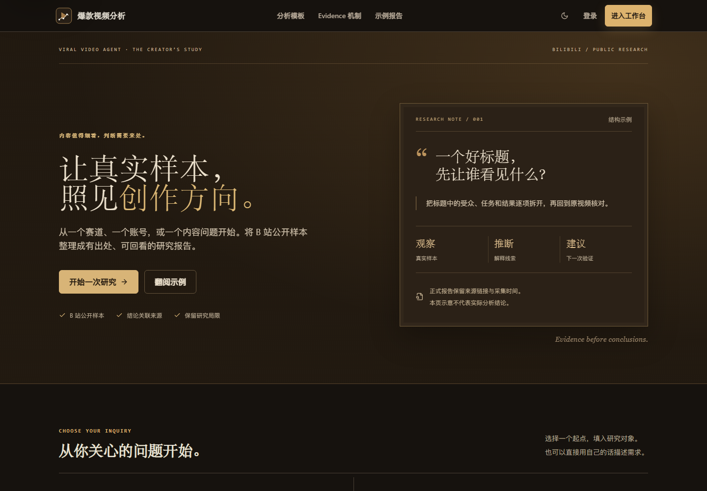
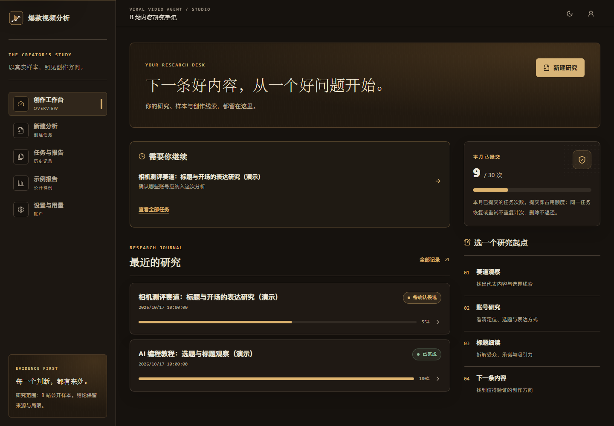
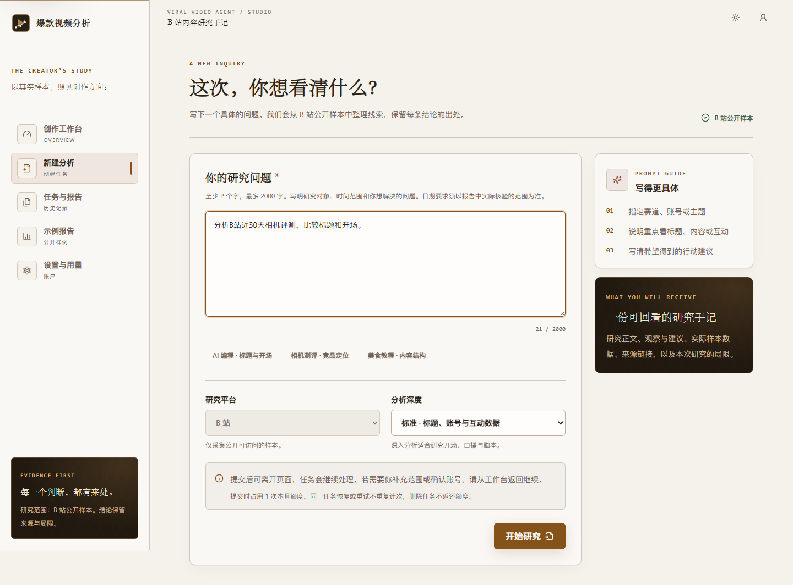

# 创作者试用版改进记录 · 2026-10-17

> 当前本机状态、验证结果和任务统一见 [项目状态](project-status.md)。本文记录本轮实现契约；源包验证数字在下方明确留作历史参考。Windows 运行以 [本地运行手册](local-development.md) 为准。

> 2026-10-18 视觉更新：下文书房设计与图片保留为 10/17 历史版本；当前界面按新要求采用暖白 / 石墨、蓝色强调、无衬线字体，默认浅色。当前样式见 [前端设计](frontend-design.md)，最新截图见 [README](../README.md#前端体验)。功能契约和历史验证结论保持。

> 2026-10-20 工程补强：领取与派发对账恢复、未决修订刷新重放、重试状态跟踪、可终止媒体进程、MCP 缓存/URL 校验及受控试用入口，以 [当前状态](project-status.md#2026-10-20-试用前工程补强) 与 [Windows 手册](local-development.md) 为准。下面的测试数字及截图保持 10/17 历史含义；工程通过仍等待网页只读复审和用户真实任务/报告验收。

## 目标与范围

这一轮为小范围创作者试用准备：让提交、等待和重试行为稳定，让额度与实际执行保持一致，让读者能够核对报告来源，同时将前端统一到受伦勃朗明暗与暖色调启发的创作者书房。

本轮沿用 B 站单平台和默认 LangGraph v2。交互澄清、候选确认仍由原有开关控制；这不是 vNext-D 或付费订阅功能的实现。以前文档中的冻结记录保留为当时验收基线，本轮新增行为以本记录与回归测试为准。

## 用户可见的变化

| 场景 | 2026-10-17 行为 |
|---|---|
| 首次进入 | 默认深色书房主题；已有主题偏好保留，仍可切换暖纸色浅色主题 |
| 提交后响应中断 | 同一请求重发返回同一个任务，不重复占用次数；同一标识被用于不同内容时返回明确冲突 |
| 多个请求争抢剩余额度 | 在用户记录上串行检查并预留，只有有额度的请求创建成功 |
| 等待与候选确认 | 后台刷新失败保留当前内容；候选选择按快照保留在当前标签页会话中 |
| 取消运行中的任务 | 先显示停止中，清理与用量保存后更新可重试状态 |
| Worker 中断 | 通过执行标识与租约隔离旧执行；调度器有限恢复丢失的执行 |
| 查看报告 | 缺失指标显示未知；展示来源、实际字段、发布日期、采集时间和样本范围；引用可定位到证据 |
| 缺少有效视频样本 | 对需要视频实证的请求生成说明边界的部分结果，不用知识库片段冒充视频样本 |

## 额度与用量语义

- `USER_MONTHLY_JOB_LIMIT` 默认 30 次，按任务提交所在的 UTC 自然月计算。
- 新建任务和范围修订各预留 1 次。相同幂等请求重发、同一个 Job 的重试不增加次数。
- 失败、取消和删除不返还次数；已经产生的模型与转写消耗保留。删除任务后用量记录的 `job_id` 置空。
- 手动重试、执行中断重试与租约恢复共用 `JOB_MAX_RETRIES`，默认最多 2 次；达到上限后不能继续重试同一任务。
- 每个执行阶段采用累计检查点结算，重复心跳或收尾不会重复累计相同消耗；澄清用量也保留独立检查点。
- ASR 只计入本次有成功响应的处理时长。缓存命中保留音频时长与转写内容，但本次消耗为 0；Researcher 的远端 MCP、本地回退与 Worker 直接转写共用执行上下文，并按调用回执去重。
- 用量代表应用能够观测到的模型使用情况及转写处理时长。供应商在响应丢失、进程突然终止等情况下可能已收费而应用尚未获得用量，不能把应用估算等同于供应商最终账单。

## 执行与报告契约

Worker 对任务执行做数据库原子认领，并用版本和独立标识约束后续写入。心跳续期并保存可观测的用量。整体超时包含澄清处理、等待并发位置、采集、转写、生成和持久化；退出时等待图任务取消完成。Redis 事件发布失败不触发已经完成报告的重复生成。

默认 v2 深度模式先采集、补转写，再执行一次分析与写作。候选确认继续复用冻结采集快照，恢复时保留决定批次。v1 兼容路径没有在本轮重构为这一阶段划分。

视频搜索保留真实零值，将缺失或非法计数归为未知。已确认且通过校验的 `TopicSpec.time_window_days` 会约束搜索视频的日期；缺失发布日期、范围外或未来发布日期的视频不纳入该范围。**没有结构化 TopicSpec 时，本轮没有实现通用自由文本日期解析**，报告会说明未确认结构化时间范围。澄清功能默认仍关闭，试用时应据此核对时间要求。

日期过滤适用于本轮升级后的新采集。升级前已经冻结、缺少发布时间字段的候选快照继续按原样恢复，恢复门禁核对视频来源和样本数量，不自动补采集或追认日期范围已通过。需要严格核验这类历史任务的日期时，应创建范围修订任务重新采集。

采集与候选恢复阶段的 Evidence Gate 检查有效样本条件；发布前校验检查 claim 结构和引用存在性。模型没有提供引用时不会自动把全部证据填给它；知识库内容可以支持方法说明，但不能替代当前视频样本。该校验不证明每条推断的语义正确，也不证明相关性等于因果关系。模型信心属于未经独立校准的自评。

## 数据库升级

迁移版本为 `20261017_0005`，上一个版本为 `20260725_0004`。升级为旧任务补充额度预留，保留已记录总消耗并初始化结算检查点；同时新增 Worker 租约字段和保留历史用量的外键规则。

已有部署升级前先停止 App 和 Worker，避免旧代码在迁移过程中继续写任务与用量。确认目标库、导出备份并在隔离库实际恢复验证后，才可执行迁移。唯一操作步骤见 [Windows 手册的备份与回退](local-development.md#现用库升级前的备份与回退)，包含本机端口覆盖和迁移失败停止处理。

`app` 的正常 Compose 启动命令也会执行 `alembic upgrade head`，不能用普通启动来探测旧库是否可用。本轮没有升级现用库或执行生产部署。

降级到 `0004` 会恢复原来不可空、删除级联的用量外键。如果已经删除任务并保留了 `job_id=NULL` 的历史用量，迁移会明确拒绝降级，避免自动删除历史账目。此时应保留新 schema 或使用升级前的数据库备份规划回退。

## 验证方式

Python 默认回归使用测试模型、工具和队列；PostgreSQL 回归需要显式提供专用测试数据库：

```sh
python -m pytest -q
PILOT_TEST_POSTGRES_URL='postgresql+asyncpg://user@host/test_db' \
  python -m pytest -q tests/test_creator_pilot_postgres.py
cd frontend
npm run lint
npm run build
```

PostgreSQL 测试为每条用例建立随机 schema，只删除自己创建的 schema；不使用应用的 `DATABASE_URL`，不迁移测试库的 `public` schema。没有配置专用 URL 时该组用例跳过。

### 源包历史结果（非本机验收）

以下数字来自网页交付包的原始记录，原件保存在本地恢复备份中。本机重新执行的结果以项目状态页为准。

| 检查 | 结果与范围 |
|---|---|
| 完整 Python 回归 | **215 passed, 6 skipped**，19.56 秒；6 个跳过项是需要显式测试库的 PostgreSQL 用例 |
| 真实 PostgreSQL 16.2 | **6 passed**，2.87 秒；旧库升级/降级、历史用量、删除保留账本、最后额度、幂等提交、创建/修订跨入口竞争及并发恢复 |
| 前端静态检查 | `npm run lint` 无警告或错误；`npm run build` 生产构建成功 |
| Chromium 134 生产页面回归 | **16 项通过**，无未处理浏览器错误；桌面 1440px、手机 375px、窄屏 320px |
| 变更完整性 | `git diff --check` 通过 |

Python 完整回归仅有一条既有 LangGraph 序列化配置弃用提示；PostgreSQL 运行包含既有 Alembic `path_separator` 配置弃用提示。本轮没有因此更新依赖。

前端视觉使用本地浏览器与固定接口响应，截图数据不代表真实创作者、实时视频或线上指标。

浏览器回归覆盖丢失提交响应后的幂等重发、刷新后重发、候选选择与理由保留、未确认项键盘聚焦、停止中继续轮询、重试上限文案、引用展开与深链接定位、零值/缺失值区分、知识来源分类、深浅主题、320px 布局以及深色主题打印。可复用脚本为 [`frontend/tests/creator-pilot.cjs`](../frontend/tests/creator-pilot.cjs)，本机新结果见 [`ui-validation.json`](../output/creator-pilot/ui-validation.json)，不与上述源包数字混用。

本地启动前端生产服务后，可使用已安装的 Playwright 包运行。Windows PowerShell 的实际路径、启动/停止与回归命令见 [本地运行手册](local-development.md#前端预览与开发)。测试运行在单独的浏览器上下文，API 全部使用脚本内的虚构夹具。

测试浏览器需要中文字体才能正常生成中文截图。本轮没有把浏览器、字体或临时 PostgreSQL 工具加入应用依赖。

### 2026-10-17 书房版页面（历史）

以下为 2026-10-17 合并后 Windows 生产页面截图，使用虚构演示夹具；源包旧图保留在导入包恢复备份中。







更多截图在 [`output/creator-pilot`](../output/creator-pilot)，包含移动首页、候选确认、深浅报告与证据详情；打印样本为 [`report-print-from-dark.pdf`](../output/creator-pilot/report-print-from-dark.pdf)。

## 小范围试用关注点

建议让首批创作者完成一次自己确实要做的选题研究：输入问题、等待结果、核对至少一条来源，再写下会采用的建议与需要重做的部分。结合完成率、有效反馈、耗时和可观测用量决定下一轮改进。

本轮没有新增收费套餐、团队协作、平台扩展或邀请管理，也没有重新执行真实付费模型 / B 站 / ASR 端到端任务。上线前的实际报告质量与外部服务可用性仍需要在部署环境中验证。
