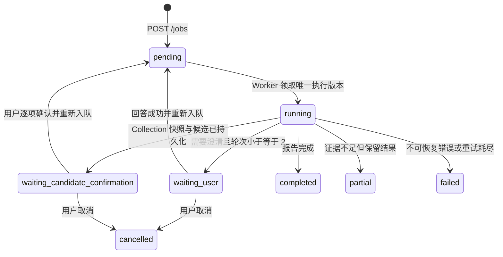

# 交互式竞争情报 vNext

> 本篇为 2026-07 冻结设计与工程记录，旧 vNext-D/E 路线暂缓。当前任务见 [项目状态](project-status.md)。本轮允许整合稳定性、证据与交互修复，当前用量累计、恢复与时间过滤语义以 [创作者试用契约](creator-pilot-20261017.md) 为准；P0-C 失败和 vNext-C 工程冻结不变。

## 产品目标

vNext-A 在现有 Agent MVP 之前增加一个可持久暂停的研究范围澄清闭环：模糊输入不立即进入 Planner、Researcher、MCP、ASR 或搜索；系统先形成一个严格的 `BriefDecision`，必要时把 Job 持久化为 `waiting_user`。用户回答后恢复同一个 Job，最多澄清两轮，形成 `TopicSpec` 后再执行现有 LangGraph。vNext-C0 补齐 B 站稳定 MID 身份；vNext-C 再把 v2 图拆成 Collection 与 Synthesis 两阶段，让用户在原始 Evidence 快照上逐项确认候选账号后继续同一个 Job。

这不是继续调 P0-C。P0-A 带保留通过、P0-B 工程 Gate 通过、P0-C 质量 Gate 失败并冻结、P0-D/P0-E 未开始。vNext 不修改 P0-C 的账号资格、评分、权重、排序、Provider、私有证据、Bundle 或归档分支。

## P0 与 vNext 边界

| 范围 | vNext-A |
|---|---|
| 模糊需求的结构化澄清 | 已实现后端底座 |
| PostgreSQL 持久暂停/恢复 | 已实现 |
| TopicSpec 传入现有分析图 | 已实现 |
| P0-C 账号质量调优 | 不做 |
| 稳定账号身份上游契约 | vNext-C0 已完成 |
| 候选账号人工确认 | vNext-C 工程 Gate 已通过并冻结 |
| 新竞争情报报告模板 | 不做，沿用现有报告链路 |
| 极简前端回答表单 | 已实现 |
| 复杂对话 UI 或视觉重构 | 不做 |

## TopicSpec Schema

`TopicSpec` 使用 Pydantic 严格校验并拒绝额外字段：

```json
{
  "topic": "相机",
  "target_content": ["相机测评", "摄影器材评测"],
  "include_creator_types": ["reviewer", "educator"],
  "exclude_content": ["旅行日志", "日常生活"],
  "time_window_days": 365,
  "allow_generalist": false,
  "competitor_definition": "持续发布相机相关内容的账号",
  "platform": "bilibili",
  "assumptions": [],
  "confidence": 0.88
}
```

平台只能是 `bilibili`；字符串、数组、时间窗口和置信度均有边界。两轮后仍未确认的范围必须进入 `assumptions`，且保守回退的置信度不会伪装为高置信度。

### TopicSpec 作为 Entry 的结构化分析契约

TopicSpec 一旦由 Brief Validator 严格校验并持久化，就接管“是否进入分析工作流”的 Entry 判定。合法且 `platform=bilibili` 的 TopicSpec 会直接进入 Planner、Researcher 和 Evidence Gate；原始 query 即使是“相机”“分析相机账号”这类无法命中旧字符串规则的模糊输入，也不会再落入 direct-answer。

原始 `analysis_jobs.query` 与图状态中的 `user_request` 保持原样，用于展示、追溯和审计。实现不覆盖用户输入，也不构造带关键词的伪请求。Entry 会把 TopicSpec 重新规范化为 Schema 输出；非空 TopicSpec 若平台、字段、边界或额外字段非法，则以 `invalid_topic_spec` 保守终止，不调用 direct-answer、Planner、Researcher 或采集工具。没有 TopicSpec 时，`requires_analysis_workflow()` 和原有不支持平台判断保持不变。

## BriefDecision

`need_clarification=true` 时必须包含一个问题、2～4 个严格选项并允许自定义回答；不能同时包含 TopicSpec。`need_clarification=false` 时必须包含合法 TopicSpec。模型 JSON、Schema 或 Provider 失败时走保守澄清。最多两轮由 Service 单点控制：初次判断可生成 round 1，第一次回答后仍不明确可生成 round 2；第二次回答后直接生成带假设、低置信度的收窄 TopicSpec，不再发起第 3 次 LLM 请求。

Brief Validator Prompt 由 `src/prompts/prompts.yaml` 管理，版本为 `brief-validator.vnext.1`。它使用默认 Planner/DeepSeek 路由，不读取 Researcher 的可选微调模型注册，因此不改变项目三模型开关语义。

## 状态机



`waiting_user` 和 `waiting_candidate_confirmation` 都表示 Worker 已正常结束且正在等待用户输入，不是失败，也不触发 Arq 自动 Retry。普通 retry 不接受这两个状态；候选等待状态可取消、可创建范围修订，并由服务端返回 `can_confirm_candidates=true`。

澄清回答与普通 retry 都先在数据库事务中锁定并校验 Job，再提交回答、`pending`、新 `execution_version` 和事件；只有提交成功后才调用 Redis/Arq enqueue。队列失败时用新事务把同一执行版本从 `pending` 转为 `failed / WORKER_FAILED` 并记录失败事件，不会静默留下没有队列任务的 `pending`。已回答的 clarification 保持 `answered`，随后可通过普通 retry 生成新执行版本恢复。

## API 契约、权限与幂等

- `JobCreate.query` 与 `JobRevisionCreate.query` 共用同一冻结边界：Pydantic 先裁剪首尾空白，再按 2～2000 字符校验。“相机”“摄影”“美食”“AI”可创建或修订；纯空白、单字符和 2001 字符输入被拒绝。
- 数据库存储裁剪后的用户原始语义；不会为了路由拼接平台、分析动作或其他关键词，也不会用 TopicSpec 覆盖 `analysis_jobs.query`。
- `GET /jobs/{job_id}/clarification`：返回当前 pending 问题、最多轮次和历史。
- `POST /jobs/{job_id}/clarification`：支持 `selected_option_id`、`custom_answer` 或二者同时提交。
- 两个接口都要求登录并复用 Job 所有权检查；其他用户统一得到 `JOB_NOT_FOUND`。
- `request_id` 必须属于当前 Job。选项 ID、文本长度和自定义回答权限均严格校验。
- 同一 `request_id` 的完全相同答案重复提交直接返回当前 Job，不再次入队；不同答案返回 HTTP 409。
- 每次首次接受回答都会增加 `execution_version`，唯一 Arq ID 为 `analysis:{job_id}:v{execution_version}`。即使客户端重试或发生队列确认不确定性，同一执行版本也不会生成另一个队列身份。
- `retry_count` 只记录重试次数，`execution_version` 只标识执行尝试；两者继续分离。

## 数据库结构

`analysis_jobs` 新增：

- `topic_spec`：可空 JSON。
- `clarification_round`：已生成的澄清轮次。
- `execution_version`：创建、普通 retry 和澄清恢复使用的执行身份；与 `retry_count` 分离。
- `interaction_usage`：Brief Validator 累计 token、估算成本和调用次数。

`job_clarifications` 保存稳定 `request_id`、Job、轮次、问题、选项、是否允许自定义、pending/answered 状态、选择项、补充文本和时间。`(job_id, round)` 与 `request_id` 均唯一；只随所属 Job 级联删除。

## Worker 暂停、恢复与用量累计

功能开启后，Worker 在任何 Planner、Researcher、MCP、ASR 或搜索之前执行 Brief Validator。需要澄清时写入 PostgreSQL、记录 `clarification_needed` 并正常返回；回答接口记录 `clarification_answered`，增加执行版本后重新入队。TopicSpec 就绪后记录 `scope_confirmed`，再调用现有图。

Brief Validator 的外部 LLM await 不长期持有或信任旧 ORM Job。LLM 返回后，Service 使用新会话锁定并重查 Job；只有状态仍为当前执行版本的 `running` 才能写入 clarification 或 TopicSpec。期间发生取消时保持 `cancelled`，旧执行版本也不能覆盖新版本；已产生的 Validator token 和估算费用仍会累计。Worker 在进入图前再次检查状态与执行版本，图执行轮询也会在取消或版本变化时停止旧任务。

每轮 Brief Validator 的用量先累计到 `analysis_jobs.interaction_usage`。等待用户期间该值不会丢失；最终 `UsageRecord` 将互动用量与后续 LangGraph/ASR 用量合并，因此不会只记录最后一次恢复后的调用。

## 为什么不依赖 MemorySaver 持久恢复

当前 LangGraph Checkpointer 是 Worker 进程内 `MemorySaver`。Worker 重启、换进程或重新部署后，该内存状态可能消失。vNext-A 因此使用 PostgreSQL 业务状态机保存问题、回答、轮次、TopicSpec、执行版本和累计用量；LangGraph 只在 TopicSpec 就绪后开始。执行版本也进入 LangGraph `thread_id`，用于隔离不同执行尝试，但这不等于 LangGraph 原生 interrupt/resume。

## 功能开关与回退

`ENABLE_INTERACTIVE_BRIEF=false` 为默认值，App 与 Worker 在 Compose 中接收同一配置。关闭时，`POST /jobs` 仍立即入队，Worker 直接进入原有 LangGraph，不调用 Brief Validator，也不改变 Planner、Researcher、Analyst、Writer 或 Researcher 微调模型路由。

`ENABLE_CANDIDATE_CONFIRMATION=false` 也是独立默认关闭开关，App 与 Worker 使用同一值，并要求 `GRAPH_VERSION=v2`。关闭时继续运行 C0 与 vNext-A/B 的既有完整图；开启时才使用 Collection / Synthesis 两阶段。修改开关需要重建 App 与 Worker 进程，不要求运行时热切换，也不改变 `USE_FINETUNED_MODEL` 的 Researcher 路由语义。

## vNext-B 冻结设计

### 澄清历史

`GET /jobs/{job_id}/clarification` 继续复用 Job 所有权检查，但把当前 `pending` 问题与已回答历史分开返回。`current` 只表示当前仍可回答的问题；`history` 只包含按 round 升序排列的已回答记录，并包含所选选项、自定义补充和回答时间。接口与页面都不暴露内部 Prompt、模型原始响应或执行密钥。

### 范围修订：创建新 Job

vNext-B 不允许原地改写已经回答的 clarification、TopicSpec 或报告。`POST /jobs/{job_id}/revisions` 根据旧 Job 创建新的分析 Job，并通过 `revision_of_job_id` 建立可追溯链；旧、新 Job 分别记录审计事件。新 Job 从 round 0、execution version 0 开始，继承平台与分析模式，但使用用户提交的新研究范围。

- `pending`、`running` 不能修订，必须先完成或取消，避免绕过当前执行版本。
- `waiting_user` 修订会在同一数据库事务中明确取消旧 Job，再创建新 Job；旧问题和已有回答仍保留。
- `failed`、`cancelled`、`completed`、`partial` 只能作为不可变来源创建新 Job。已有报告和用量不会被清除或覆盖。
- 重复提交使用新的幂等键返回同一个修订 Job；同一幂等键若指向其他任务或不同修订内容则返回冲突。

没有选择“重置同一 Job 的 clarification round、删除旧回答再重跑”，因为这会混淆审计、执行版本和报告归属。也没有在 vNext-B 引入可编辑 TopicSpec：当前最小方案让每次范围变化都对应一个独立、可回滚和可比较的 Job。

### 派发 reconciliation

vNext-B 使用最小 PostgreSQL reconciliation，而不是完整 transactional outbox。每次创建、回答、retry 或范围修订在提交 `pending` 与新执行版本时，同时写入 `dispatch_pending_at` 并清空 `arq_job_id`。enqueue 成功后保存确定性 Arq ID 并清除该时间；API 已确认的 enqueue 失败仍转为 `failed / WORKER_FAILED`。

Worker 每分钟执行一次有限批量扫描，只租约超过安全阈值的 `status=pending AND arq_job_id IS NULL AND dispatch_pending_at IS NOT NULL` 记录。租约会把时间推进到当前时刻，避免多 Worker 高频重复；恢复始终复用原 `execution_version` 和 `analysis:{job_id}:v{execution_version}`，不增加 `retry_count`。成功、失败和开始尝试都有审计事件；失败保留 pending 并给出可取消后恢复的明确提示，下一次尝试仍需重新等待安全阈值。

完整 outbox 没有被采用，因为当前系统只有一种确定性 Arq 派发消息，PostgreSQL 状态已经包含全部重建参数；增加 outbox 表、发布器和消息生命周期会扩大 migration 与运维面。reconciliation 能直接覆盖 commit 后进程退出，以及 Redis 已接收但数据库未保存 Arq ID 两种窗口，同时保持重复调用幂等。

### vNext-B 合同与配置

- Migration `20260723_0003_interactive_vnext_b.py` 增加 `revision_of_job_id`、`dispatch_pending_at`、外键和派发扫描索引。
- API 增加 `POST /jobs/{job_id}/revisions`；澄清读取继续使用原路径，但明确返回 `current` 与 `history`。
- `JobRead.can_retry` 由服务端统一计算：仅 `failed`、`cancelled`、`partial` 且不存在 pending clarification 时为 true；retry 接口复用同一规则。
- `JobRead.can_revise` 表示 Job 状态可作为修订来源：`waiting_user`、`failed`、`cancelled`、`completed`、`partial` 为 true；用量和 ASR 能力仍由提交接口最终校验。
- 两个能力都是响应层计算值，不新增数据库布尔列。前端只依据能力显示操作；后端仍是并发和状态变化的最终防线。
- 审计事件增加 `scope_revision_created`、`scope_revision_started`、`dispatch_recovery_started`、`dispatch_recovered`、`dispatch_recovery_failed`。
- `DISPATCH_RECONCILE_MIN_AGE_SECONDS` 默认 60 秒，`DISPATCH_RECONCILE_BATCH_SIZE` 默认 50；Worker 每分钟扫描一次，不忙等待。

## vNext-C0 稳定账号身份数据契约

vNext-C0 是 vNext-C 之前的独立先决条件，只修复 `search_videos` 到 raw data / Evidence 的账号身份丢失，不实现候选生成或人工确认。

每条解析后的 B 站视频新增：

```json
{
  "platform_account_id": "12345",
  "display_name": "账号显示名称",
  "profile_url": "https://space.bilibili.com/12345"
}
```

- `platform_account_id` 只接受 B 站响应 `owner.mid` 中可规范化的正整数；整数、纯 ASCII 数字字符串和前导零字符串统一为无前导零字符串。
- `profile_url` 必须由合法 MID 确定性生成，且严格等于 `https://space.bilibili.com/{mid}`。
- `display_name` 只用于展示；不能用作唯一身份，不能用于同名账号合并，也不能在缺少 MID 时拼接或猜测主页。
- 缺失、零、负数、布尔值、浮点数或含非数字字符的 MID 均产生 `platform_account_id=null`、`profile_url=null`。
- `BilibiliAccountIdentity` 使用 Pydantic strict mode、`extra=forbid` 和不可变模型；主页与 MID 不匹配时拒绝。
- 现有 `author` 保留并等于 `display_name`，避免破坏 Analyst、Writer 和既有调用者。
- 三个身份字段进入搜索 raw data，并进入 Evidence `data_fields` 的有限投影；Evidence ID 仍由视频来源身份确定，不因账号显示名变化而变化。

C0 没有新增数据库 Schema、Migration、API、状态、功能开关或前端。它不生成 `candidate_id`，不宣称账号是竞品，不调用额外 B 站接口，也不证明候选质量。完整验证见 `docs/interactive-intelligence-vnext-c0-validation-20260725.md`。

## vNext-C 候选账号人工确认闭环

### 最小真实身份 Canary

实施前只对既有公开 B 站入口进行一次受限 Canary：1 个公开 HTTP 请求，最多读取 10 条结果；10/10 包含合法 MID，10/10 可生成规范主页，BVID、标题和 URL 完整率均为 100%，Provider 正常且无错误。没有使用 Cookie、登录、代理、浏览器指纹或风控绕过；LLM、MCP、UAPI、ASR 调用均为 0，费用为 0。只记录聚合统计，没有输出或保存真实 MID、账号名、标题或完整响应。

### Collection / Synthesis 分阶段图

`build_collection_graph_v2()` 和 `build_synthesis_graph_v2()` 复用现有节点函数，不复制 Agent 实现：

- Collection：Entry → Planner → Researcher → Evidence Gate → 候选提取 → PostgreSQL 快照 → `waiting_candidate_confirmation`。
- Synthesis：从 PostgreSQL 校验并恢复原快照 → 只筛选 confirmed Evidence → Analyst → Writer → 现有 Claim / Evidence / 报告校验与持久化。

Synthesis 图不包含 Entry、Planner、Researcher 或 Evidence Gate；候选确认后的 Worker 也不再调用 Brief Validator、搜索、MCP、UAPI 或 ASR。恢复不依赖进程内 `MemorySaver`，并使用新的 `execution_version` 与 `candidate_synthesis_runs` 绑定本次决策。

Gate 阻塞修复后，两字符模糊主题可以通过 `POST /jobs` 到达 Brief Validator；Collection 的 Entry 同时接受经过验证的 TopicSpec 作为结构化分析意图，不再只依赖 query 关键词。组合测试使用真实 API、Brief Service、clarification API、Worker 和 `build_collection_graph_v2()`，证明“相机 → waiting_user → TopicSpec → Collection → waiting_candidate_confirmation”。该修复不改变候选提取、排序、MID 身份、快照、用户决策、报告过滤或 P0-C 逻辑。

### 候选身份、排序与快照

- `candidate_id` 为 `cand_` 加 `sha256("bilibili|mid:{mid}")` 的前 24 位十六进制摘要。
- 只接受 C0 的合法 `platform_account_id`；同 MID 合并，同名不同 MID 分离，无 MID 不生成候选。
- 排序依次为匹配 Evidence 数降序、首次 Evidence 出现顺序、MID 稳定排序，最多 8 个。
- `display_name` 只展示；`why_surfaced` 只说明搜索样本来源，不宣称候选必然是竞品。
- `collection_snapshots` 保存 TopicSpec、计划、最小 raw data、Evidence、工具结果、查询和采集用量；`candidate_snapshots` 与候选行保存有限投影和稳定哈希。
- 快照按 `job_id + source_execution_version` 唯一且不可变；用户决策保存在独立 decision batch/rows 中，不覆盖系统候选事实。

Migration `20260725_0004_candidate_confirmation.py` 新增 `collection_snapshots`、`candidate_snapshots`、`candidate_accounts`、`candidate_decision_batches`、`candidate_decisions`、`candidate_synthesis_runs`，并把 `analysis_jobs.status` 从 `varchar(20)` 扩为 `varchar(40)`。Job 删除只级联自己的快照；范围修订产生新 Job，不继承旧候选决策作为真值。

### API、幂等与能力

- `GET /jobs/{job_id}/candidates`：只返回最多 8 个候选的有限投影、TopicSpec 摘要、当前 decision、快照版本/哈希和 `can_submit`。
- `POST /jobs/{job_id}/candidates/decisions`：要求当前用户拥有 Job 与快照，所有候选必须各选一次，至少一个 confirmed，不接受 undecided、未知或重复 ID，reason 最长 200 字，请求体上限 16 KiB。
- 同一 `request_id` 和同一规范化 payload 幂等返回，不增加执行版本或重复入队；同一 `request_id` 的不同内容返回 409。首次接受时事务内保存决策、增加 `execution_version`、清除旧 `arq_job_id`、写入 `dispatch_pending_at`，提交后再 enqueue；派发失败保留 reconciliation 意图。
- `can_retry=false`、`can_revise=true`、`can_confirm_candidates=true` 由服务端状态计算，前端只消费能力。

### 报告边界

Synthesis 重新计算并校验采集哈希、候选哈希和决策哈希。confirmed 候选对应的视频 Evidence 与同源 Transcript Evidence 才会交给 Analyst / Writer；excluded 不进入正常竞品结论；uncertain 只进入确定性的“未纳入或待确认范围”。最终报告明确披露候选来自系统检索、纳入由用户确认、结论只适用于本次公开 Evidence 快照，以及用户确认不等于模型准确率或市场覆盖。

完整工程、Migration、浏览器与安全验证见 `docs/interactive-intelligence-vnext-c-validation-20260725.md`。

## 已完成与未完成

vNext-A 已完成严格契约、PostgreSQL 暂停/恢复、执行版本和默认关闭兼容链路。vNext-B 已完成并冻结澄清历史、创建新 Job 的范围修订、审计关系、派发 reconciliation、错误提示和极简前端入口。vNext-C0 已完成稳定账号身份数据契约的工程验证。vNext-C 已完成候选提取、不可变快照、用户逐项确认、同 Job 恢复与 confirmed-only Synthesis 的工程闭环，工程 Gate 已通过并冻结，不再继续修改。

PostgreSQL 业务状态机仍不等于 LangGraph 原生 interrupt/resume。vNext-C Canary 只证明当前公开入口能返回稳定 MID，用户确认闭环只证明工程边界和可恢复性；用户入口组合测试只证明短主题能经澄清到达真实 Collection。它没有证明自动候选质量提升、模型准确率、稳定 Top 5、完整行业覆盖或生产部署。P0-C 继续失败冻结。

## 后续阶段

- vNext-B：已完成并作为 C0 基线冻结。
- vNext-C0：稳定账号身份数据契约，已完成工程验证并作为 C 基线冻结。
- vNext-C：候选账号人工确认闭环，工程 Gate 已通过并冻结。
- vNext-D：竞争情报报告交互与证据体验，尚未开始；需要独立任务和明确授权，不得由 C 自动进入。
- vNext-E：端到端 Gate、真实边界验证和面试材料统一同步。
