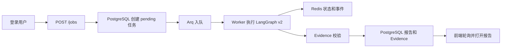

# B站单平台产品 MVP 架构

当前实施主线与任务见 [项目状态](project-status.md)，Windows 操作见 [本地运行](local-development.md)。本篇描述合并后的实现，不表示已完成真实创作者试用或生产部署。

## 页面信息架构

- 公共：首页、注册、登录、示例报告、公开分享报告
- 登录后：Dashboard、新建分析、任务进度、报告详情、历史任务、设置与用量
- 旧 `/report/{id}` 保留兼容跳转，正式报告路径为 `/reports/{id}`

## 任务流

第一版进度读取采用可靠轮询。Worker 同时把短期状态写入 Redis Hash/Stream，后续可以在不改变任务模型的前提下增加跨 Worker SSE。

## 状态与恢复

- `pending`：已持久化并等待 Worker
- `running`：Worker 原子认领，执行版本、独立 token 和心跳租约隔离旧执行
- `waiting_user`：等待澄清回答（开关默认关闭）
- `waiting_candidate_confirmation`：等待候选逐项确认（独立开关默认关闭）
- `completed`：报告和引用校验通过
- `partial`：保留可用结果，并明确证据不足
- `failed`：保存产品错误码与可读说明
- `cancelled`：用户取消；`is_stopping=true` 时继续轮询，等待 Worker 清理并保存可观测用量

Worker 使用有限重试、指数退避、总超时与 Provider 并发信号量。API 幂等键在 `(user_id, idempotency_key)` 上唯一。

提交和范围修订在用户级事务内预留 UTC 自然月额度。相同幂等键、相同请求返回已有任务；不同请求返回冲突。失败、取消、删除不退还次数；同一任务重试不重复计次。手动重试、自动重试及过期租约恢复共用上限。用量按执行 token 的累计检查点结算；删除任务保留账目。迁移 `20261017_0005` 与 API、Worker 必须配套使用。

## 数据职责

| 组件 | 职责 |
|---|---|
| PostgreSQL | 用户、任务、报告、Evidence、反馈、用量、分享链接 |
| Redis | Arq 队列、临时状态、事件、锁、转写缓存 |
| ChromaDB | 知识库向量 |
| LangGraph Checkpointer | 当前仍为进程内短期图状态；业务恢复以任务与报告表为准 |

## 标准分析与 ASR 深度分析

标准分析链路：用户提交 → B站公开关键词搜索（失败或空时回退排行榜/热门池）→ RAG → LangGraph Agent 分析 → Evidence 校验 → PostgreSQL 保存报告。

默认 v2 深度链路：用户提交 → Collection 采集和证据门禁 → 选择最多 `ASR_MAX_VIDEOS` 个符合时长边界的唯一公开 B 站视频 → `yt-dlp` 提取临时音频 → `ffmpeg` 压缩 → MiMo ASR → Transcript Evidence → 一次 Synthesis（Analyst/Writer）→ PostgreSQL 保存 → 临时目录自动删除。v1 保留原兼容路径，不宣称采用相同阶段划分。

`ASR_MAX_VIDEOS` 默认 5、合法范围 1～5。系统没有独立的全站 Top N 质量重排器，也不要求用户上传音频。全部转写失败时降级为元数据分析并记录 warning，报告不得假装读取过视频内容。

Agent LLM 默认使用 DeepSeek；网关也支持通过 `provider=mimo` 使用余额扣费 Key 和 MiMo 公共 OpenAI 兼容接口。MiMo LLM 与 MiMo ASR 共享凭证时仍走独立客户端，ASR 工具错误或缺少来源的非结构化结果不会进入 Evidence。

## 报告与交互边界

- 视频实证请求须有有效 B 站视频/适用转写样本；知识库方法资料不能冒充本次视频样本，证据不足保存部分结果。
- 缺失计数为未知，真实 0 保留。发布时间、采集时间、样本数和结构化时间范围分别披露；未启用澄清时，自由文本日期不保证经过过滤。
- 用户确认候选后复用 PostgreSQL 快照，不重新搜索或转写。历史快照不自动补采集，也不追认升级前日期筛选通过。
- 报告引用跳转到证据卡片；结构和引用校验不证明语义真实性，模型信心是未经校准的自评。
- 新建任务在响应丢失时保留提交标识和可恢复的待提交草稿；候选选择按快照保存于当前标签页会话。
- 暖白浅色与石墨深色主题共用语义颜色、系统无衬线字体、蓝色强调、导航和报告组件；首次访问默认浅色，已有偏好保留；当前截图来自 2026-10-18 本机夹具浏览器回归。
